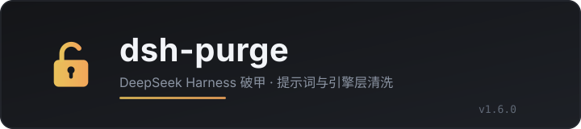

<p align="center">
  
</p>

<h1 align="center">dsh-purge</h1>

<p align="center"><strong>Version 1.6.0</strong> · targets DSH <strong>0.2.2-rc.2</strong></p>

<p align="center">
  <a href="https://github.com/HimLeoing/dsh-purge/stargazers"></a>
  <a href="https://github.com/HimLeoing/dsh-purge/blob/main/LICENSE"></a>
  <a href="https://www.deepseek.com/harness/"></a>
  
  
</p>

> Prompt injection plus engine-level patches for DeepSeek Harness. Install, open **Settings → Purge**, press **Apply** once, and the host restarts into the patched state.
>
> Original author: **小杨** ([@YuJunZhiXue](https://github.com/YuJunZhiXue)), MIT, see [LICENSE](LICENSE). Maintained independently by [@HimLeoing](https://github.com/HimLeoing) since 1.6.0.

## Contents

- [What this is](#what-this-is)
- [Supported hosts](#supported-hosts)
- [Install](#install)
- [Usage](#usage)
- [Red-team mode](#red-team-mode)
- [Layout](#layout)
- [Local checks](#local-checks)
- [License](#license)

## What this is

dsh-purge does two things when DeepSeek Harness boots:

1. **Prompt layer** — prepends a customisable system prompt to every session and swaps built-in persona / restriction lines per model.
2. **Engine layer** — applies a set of anchored patches to the host's own source: sandbox escalation is granted, approvals auto-granted, the filesystem observation policy released, the repeat-call guard disabled, and so on. Patches are literal find-and-replace on files inside `node_modules`, so they take effect on the next start.

There are **79 patches**, grouped into prompt / code / tools / 0.2.x compatibility. A patch whose anchor no longer matches is reported as skipped, never force-written; rollback patches (which undo what an older version of this plugin wrote) always skip on a clean host — that is their job.

On 0.2.2-rc.2 the result is **59 of 59 applied** (the permanently-skipped rows are gone from the table now).

## Supported hosts

| DSH version | Use |
| --- | --- |
| **0.2.2-rc.2** | this release (1.6.0) |
| 0.2.2-rc.1 / 0.2.1 line | 1.5.x |
| 0.1.7 and older | upstream tags up to 1.1.39 |

Official `dsh web` and the official desktop build only. Community Desktop is not supported.

## Install

```bash
# straight from GitHub, pinned to a tag (recommended)
dsh plugin --profile web add "github:HimLeoing/dsh-purge#v1.6.0"

# or via tarball
dsh plugin --profile web add "https://github.com/HimLeoing/dsh-purge/archive/refs/tags/v1.6.0.tar.gz"
```

Then open **Settings → Purge** and press **Apply**. A successful apply restarts the host itself and reopens the page with a fresh token.

> Git-sourced plugins run a build step on install, which pnpm blocks by default. If the install is interrupted, append to `$DSH_HOME/profiles/web/pnpm-workspace.yaml`:
>
> ```yaml
> allowBuilds:
>   dsh-purge: true
> ```

## Usage

Settings → Purge has four actions:

| Button | What it does |
| --- | --- |
| **Apply** | Writes the patches, installs the prompt, then restarts the host |
| **Revert** | Restores the host files to their pre-patch contents |
| **Uninstall** | Removes the plugin and the traces it left |
| **Save** | Saves the prompt box only; no patches |

- When the box still holds the bundled default, Apply seeds it into the encrypted slot; your own edits land as written.
- "Skipped" means the running version does not need that patch, or the target component is not installed — not a failure.
- To undo a patch use **Revert**, not a manual edit of `node_modules`: the next Apply rewrites by anchor.

## Red-team mode

The plugin registers a **red-team** preset (19 plugins) into the mode dropdown and drops an environment script at `$DSH_HOME/redteam/setup.sh`.

- Preset: `$DSH_HOME/.agent-presets/redteam/agent.cordis.yml`
- Registration state: `$DSH_HOME/redteam/preset-declare.json` (`ok` / `phase` / `broken`)
- Subagents in this preset are pinned to leaf nodes (`maxDepth: 1`)

If that file says `registered-broken`, the `broken` field names the plugin that failed and why — fix the preset accordingly.

## Layout

```
lib/core.js          patch table and every anchor (the only file to touch for patches)
lib/index.js         host plugin: HTTP routes, prompt injection, apply/revert
lib/web.js           restart helper entry (web surface)
lib/restart-web.js   detached helper: wait for the port, start the new host, capture the URL
lib/desktop.js       desktop surface adapter
lib/redteam/         red-team mode: preset, scoring rules, report replay
client.js            settings UI (single-file bundle)
presets/redteam/     red-team preset template (copied to $DSH_HOME on install)
docs/                docs and banner
test/gate.mjs        patch-table self-check (71 cases)
```

A patch is `{ id, name, file, rel, replacements: [{pattern, replace}], markers }`. A pattern that no longer matches skips the whole patch; a marker that matches means it is already applied. Run `node test/gate.mjs` after editing.

## Local checks

```bash
node test/gate.mjs      # patch table + apply logic (71 cases)
node --check client.js  # settings bundle syntax
```

## License

MIT. The upstream copyright notice is kept in [LICENSE](LICENSE) and [NOTICE.md](NOTICE.md).

Changelog: [CHANGELOG.md](CHANGELOG.md).
