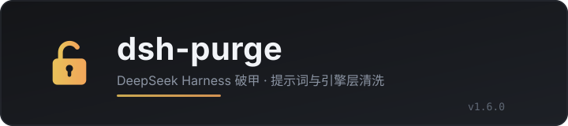

<p align="center">
  
</p>

<h1 align="center">dsh-purge</h1>

<p align="center"><strong>Version 1.6.0</strong> · 适配 DSH <strong>0.2.2-rc.2</strong></p>

<p align="center">
  <a href="https://github.com/HimLeoing/dsh-purge/stargazers"></a>
  <a href="https://github.com/HimLeoing/dsh-purge/blob/main/LICENSE"></a>
  <a href="https://www.deepseek.com/harness/"></a>
  
  
</p>

> DeepSeek Harness 破甲：提示词注入 + 引擎层补丁。装好后在「设置 → Purge」点一次「应用」，宿主重启即生效。
>
> 上游原作者：**小杨**（[@YuJunZhiXue](https://github.com/YuJunZhiXue)），MIT 许可，见 [LICENSE](LICENSE)。本仓库自 1.6.0 起由 [@HimLeoing](https://github.com/HimLeoing) 独立维护。

## 目录

- [这是什么](#这是什么)
- [适配范围](#适配范围)
- [安装](#安装)
- [用法](#用法)
- [红队模式](#红队模式)
- [目录结构](#目录结构)
- [本地检查](#本地检查)
- [许可](#许可)

## 这是什么

dsh-purge 在 DeepSeek Harness 启动时做两件事：

1. **提示词层**：把一段可自定义的系统提示词挂到每个会话前面，并按模型替换内置的人设与限制句。
2. **引擎层**：对宿主源码打一组锚点补丁——沙箱升级放行、审批自动授予、文件观察策略放行、重复调用守卫关闭等。补丁以「命中即替换」的方式写进 `node_modules` 里的实际文件，重启后生效。

补丁表共 **79 条**，分提示词 / 代码 / 工具 / 0.2.x 兼容四层。锚点对不上的补丁显示为跳过，不会盲目改写；回滚型补丁（例如撤回旧版本自己写进去的改动）在干净宿主上必然跳过，属正常。

0.2.2-rc.2 上的实际结果：**59 项全部 applied**（跳过项已移除，不再计入）。

## 适配范围

| DSH 版本 | 用法 |
| --- | --- |
| **0.2.2-rc.2** | 本版（1.6.0） |
| 0.2.2-rc.1 / 0.2.1 线 | 1.5.x |
| 0.1.7 及更早 | 上游 1.1.39 及更早的 tag |

只支持官方 `dsh web` 与官方桌面端。社区桌面端不做适配。

## 安装

```bash
# 从 GitHub 直接装（推荐，锁定 tag）
dsh plugin --profile web add "github:HimLeoing/dsh-purge#v1.6.0"

# 或走 tarball
dsh plugin --profile web add "https://github.com/HimLeoing/dsh-purge/archive/refs/tags/v1.6.0.tar.gz"
```

装完打开 **设置 → Purge**，点 **应用**。应用成功后宿主会自己重启，页面会用新令牌重新打开。

> git 来源的插件在安装时要跑构建脚本，pnpm 默认会拦。若安装被中断，在 `$DSH_HOME/profiles/web/pnpm-workspace.yaml` 末尾加：
>
> ```yaml
> allowBuilds:
>   dsh-purge: true
> ```

## 用法

设置 → Purge 只有四个动作：

| 按钮 | 作用 |
| --- | --- |
| **应用** | 写补丁 + 挂提示词，然后自动重启宿主 |
| **还原** | 把宿主文件恢复成补丁前的原始内容 |
| **卸载** | 移除插件并清理它留下的痕迹 |
| **保存** | 只保存提示词框里的内容，不写补丁 |

- 提示词框里是插件默认稿时，应用会自动把它刷进加密槽；你自己改过的稿按框落盘。
- 「跳过」= 当前版本不需要，或目标组件没装；不是失败。
- 撤销某条补丁请用「还原」，不要手改 `node_modules`——下次应用会按锚点重新写。

## 红队模式

插件会向「模式」下拉注册一个 **红队模式** 预设（19 个插件），并落一份环境脚本到 `$DSH_HOME/redteam/setup.sh`。

- 预设定义：`$DSH_HOME/.agent-presets/redteam/agent.cordis.yml`
- 注册状态：`$DSH_HOME/redteam/preset-declare.json`（`ok` / `phase` / `broken`）
- 子代理在该预设里固定为叶子节点（`maxDepth: 1`）

如果这个文件显示 `registered-broken`，`broken` 字段会写明是哪个插件没起来、为什么——按它说的改预设即可。

## 目录结构

```
lib/core.js          补丁表与全部锚点（改补丁只动这里）
lib/index.js         宿主插件：HTTP 路由、提示词注入、应用/还原
lib/web.js           重启助手入口（网页面）
lib/restart-web.js   detached 重启助手：等端口释放 → 起新宿主 → 抓新地址
lib/desktop.js       桌面面适配
lib/redteam/         红队模式：预设、评分规则、报告回放
client.js            设置页 UI（单文件 bundle）
presets/redteam/     红队预设模板（安装时复制到 $DSH_HOME）
docs/                文档与 banner
test/gate.mjs        补丁表自检（71 项）
```

补丁的写法：一条补丁 = `{ id, name, file, rel, replacements: [{pattern, replace}], markers }`。`pattern` 对不上就整条跳过；`markers` 命中即视为已应用。改补丁后跑 `node test/gate.mjs`。

## 本地检查

```bash
node test/gate.mjs      # 补丁表结构 + 应用逻辑（71 项）
node --check client.js  # 设置页 bundle 语法
```

## 许可

MIT。上游版权声明保留在 [LICENSE](LICENSE) 与 [NOTICE.md](NOTICE.md) 中。

变更记录见 [CHANGELOG.md](CHANGELOG.md)。
